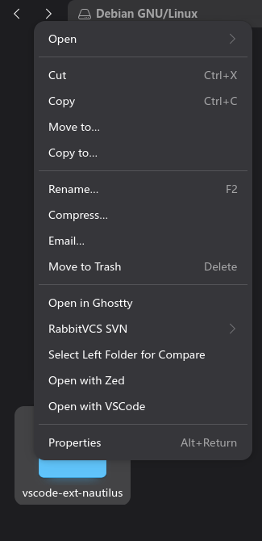

# VSCode Nautilus Extension

A native C extension that adds an **"Open with VSCode"** context-menu entry to
the GNOME Nautilus file manager.

Right-click any file or folder in Nautilus and open it directly in
[Visual Studio Code](https://code.visualstudio.com).



## Why

Visual Studio Code ships without a Nautilus integration: there is no "Open
with VSCode" entry in the GNOME file manager's context menu. Opening a project
from the file manager therefore means launching `code` from a terminal or
dragging folders into an existing window.

This extension closes that gap with a small, dependency-light native library
that plugs directly into Nautilus' extension system
(`libnautilus-extension`) — the same approach as our sibling
`zed-editor-ext-nautilus` project.

## Features

- **"Open with VSCode" context-menu entry** for files and folders
- **Auto-hides when VSCode is uninstalled** — the entry checks on every menu
  build that VSCode is still installed and stays hidden otherwise, without
  restarting Nautilus
- **Multi-selection support** — every selected path is passed to VSCode at once
- **Fire-and-forget launch** — spawns `code` asynchronously with stdout/stderr
  redirected to `/dev/null`, so the file manager stays clean
- **Native and zero-dependency at runtime** — a single GObject-based shared
  library; no Python, no daemons, no extra runtime dependencies

## Requirements

| Tool | Purpose |
| --- | --- |
| GNOME Nautilus | Host file manager (tested on **Debian 13 / GNOME 47+**) |
| `libnautilus-extension-dev` | Nautilus extension API |
| `libglib2.0-dev`, `libgtk-3-dev` | GObject / GTK headers |
| `gcc` + `make` + `pkg-config` | Build toolchain |
| Visual Studio Code | The editor to launch (`code` reachable on `PATH`, or at `/usr/bin/code`) |

## Build & Install

```bash
make                 # compile vscode_nautilus_extension.so
sudo make install    # copy to /usr/lib/x86_64-linux-gnu/nautilus/extensions-4/
nautilus -q          # restart Nautilus
```

To uninstall, remove the installed shared library:

```bash
sudo rm /usr/lib/x86_64-linux-gnu/nautilus/extensions-4/vscode_nautilus_extension.so
nautilus -q
```

## Usage

After installation, right-click one or more files/folders in Nautilus and
select **Open with VSCode**. All selected items are opened in a single VSCode
window — a new one by default, since the extension spawns `code` without the
`--reuse-window` flag.

## How It Works

1. Whenever a context menu is requested, the extension checks that VSCode is
   still installed — by scanning the XDG applications dirs for a desktop
   entry that launches the `code` CLI (whatever the file is named), plus the
   hard-coded launcher `/usr/bin/code` and a `code` executable on `PATH`.
   If none is found (e.g. VSCode was uninstalled), no menu item is created.
2. Otherwise it creates a single `NautilusMenuItem` labelled
   "Open with VSCode" (`vscode::open`).
3. On activation, each `NautilusFileInfo` URI is converted to a local
   filesystem path with `g_filename_from_uri()`; items that cannot be
   converted (e.g. remote shares) are skipped.
4. The argument vector `/usr/bin/code <path1> <path2> ...` is launched
   via `g_spawn_async()` with `G_SPAWN_SEARCH_PATH`, so the `code` binary is
   also resolved from `PATH`. stdout/stderr are redirected to `/dev/null` to
   keep Nautilus free of terminal output.

## Development

### Project layout

```
├── Makefile                      # build / install / clean targets
├── vscode_nautilus_extension.c   # the Nautilus extension (GObject + NautilusMenuProvider)
└── assets/
    └── nautilus_vscode.png       # context-menu screenshot used in this README
```

### Adding a change

```bash
make clean && make   # compile with -Wall
```

### Release checklist

- [ ] `make` builds cleanly with `-Wall`
- [ ] Context menu verified in a live Nautilus session

## Compatibility

Currently tested **only** on:

- **Debian 13** (Trixie)
- **GNOME 47+** / Nautilus 47+
- x86_64 (install path `/usr/lib/x86_64-linux-gnu/nautilus/extensions-4/`)

Other distributions (Fedora, Arch, openSUSE, …) use different extension
directories; adjust `INSTALL_DIR` in the `Makefile` accordingly. Older Nautilus
versions with the legacy `extensions-3.0` directory are not supported.

## Known Limitations

- The launcher path is hard-coded to `/usr/bin/code` (with a `PATH` fallback
  via `G_SPAWN_SEARCH_PATH`). Snap (`/snap/bin/code`) and Flatpak
  (`flatpak run com.visualstudio.code`) installations are not detected.
- Non-local selections (remote mounts, etc.) cannot be converted to local
  paths and are silently skipped.
- Launching is fire-and-forget: VSCode starts in the background without a
  terminal attached, matching typical desktop-launcher behavior.
- Only the Nautilus context menu is provided; no drag-and-drop or file-type
  associations are registered.

## License

No license is declared yet. All rights reserved by default — if you intend to
redistribute or modify this project, contact the author first.